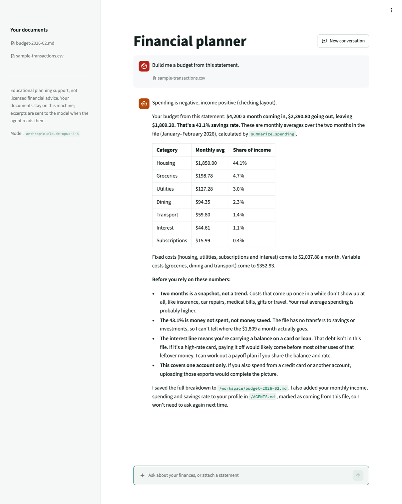
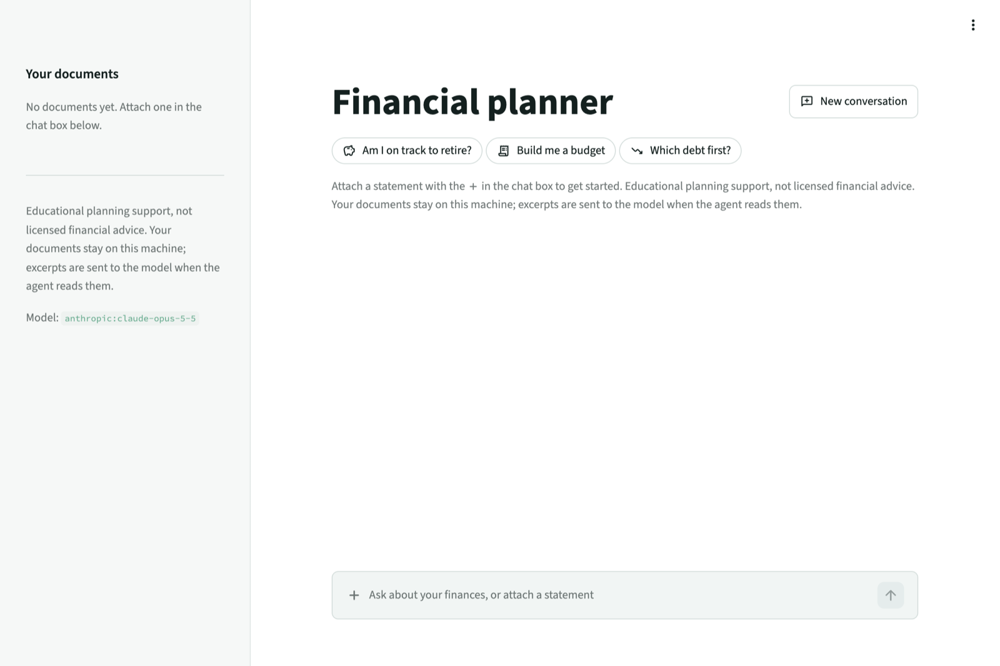

# Financial Planner Agent

A personal financial planning agent built on
[Deep Agents](https://docs.langchain.com/oss/python/deepagents/overview), with a
Streamlit chat UI. It runs on your own machine and works from your own exports.

- **Budget** from a bank or card CSV/XLSX export: spending by category and month,
  savings rate, monthly averages.
- **Retirement readiness**: accumulation, then drawdown, then a seeded Monte Carlo
  probability that the money lasts.
- **Debt strategy**: avalanche vs snowball, and paying down debt vs investing.
- **Market data**: quotes, fund expense ratios, historical returns, and current
  rates and limits from the web.
- **Memory**: it keeps a household profile between sessions.

<picture>
  <source media="(prefers-color-scheme: dark)" srcset="docs/screenshots/answer-dark.png">
  
</picture>

> **Not financial advice.** This is an educational planning tool. It is not a
> licensed financial advisor and does not give personalized investment, tax or
> legal advice. For consequential decisions, talk to a fee-only fiduciary.

## Quickstart

```bash
uv sync
cp .env.example .env      # add your ANTHROPIC_API_KEY
uv run streamlit run app.py
```

<picture>
  <source media="(prefers-color-scheme: dark)" srcset="docs/screenshots/home-dark.png">
  
</picture>

Attach a CSV or XLSX export in the chat box, or try
`examples/sample-transactions.csv` to see it work without your own data. PDFs are
accepted for reading only, because a budget needs columns (see
[PDFs are readable, not aggregatable](#pdfs-are-readable-not-aggregatable)).

The app binds to loopback only, as long as you run that exact command from the
repository root and pass no `--server.address`. See
[The Streamlit config](#the-streamlit-config) for why that depends on one file.

The interface has matching light and dark themes (under **Settings** in the app
menu) and loads no web fonts. It reflows from a narrow window to a wide monitor.
On a narrow window the sidebar collapses, so nothing you need lives only there:
**New conversation** is in the header row, and the disclaimer appears under a new
conversation's suggestions and in the menu's **About**.

## How it's put together

| Path | Purpose |
|---|---|
| `app.py` | Streamlit chat UI |
| `src/financial_planner/agent.py` | Assembles the deep agent: model, tools, prompt, backend |
| `src/financial_planner/finance.py` | Pure financial math, no LangChain imports |
| `src/financial_planner/tools/` | Calculators, document ingestion, market data, web search |
| `src/financial_planner/prompts.py` | The system prompt, which enforces the arithmetic rule |
| `src/financial_planner/streaming.py` | Translates LangGraph stream events into UI events |
| `src/financial_planner/envelope.py` | The JSON result envelope every tool returns, and secret redaction |
| `src/financial_planner/rendering.py` | Markdown preparation for Streamlit |
| `src/financial_planner/uploads.py` | Untrusted upload names → safe, non-colliding workspace paths |
| `src/financial_planner/config.py` | Paths and credentials, read from the environment at import time |
| `agent_home/` | The agent's entire filesystem view |

## Design

### The arithmetic rule

**The model never does the math.** Every figure comes from a tool, never from the
model's own arithmetic. A language model will produce a *plausible*
compound-interest number that is wrong by tens of thousands of dollars, and the
reader has no way to tell.

Most figures come from `finance.py`, wrapped by `tools/calculators.py`. Two tools
compute their own: `get_historical_return` derives a CAGR, volatility and realized
swings from a price series, and `summarize_spending` aggregates in pandas. The rule
is about *where* a number is computed (in a tool), not which module computes it.

The rule covers ratios too. `summarize_spending` returns `savings_rate` and
`by_category_share_of_income` so the model never has to divide. The model can only
obey the rule if a tool offers the number, which is why those keys exist.

The system prompt enforces the rule. `tests/test_finance.py` pins every calculation
with externally verifiable values (a standard mortgage payment, textbook compound
growth), invariants (avalanche never costs more than snowball), round-trips and
error paths.

Annual-to-monthly rate conversion is done **two ways on purpose**:

- **Investment returns** use the geometric `(1+r)^(1/12) − 1`, because "7% expected
  return" means 7% effective.
- **Debt** uses `APR/12`, the convention US lenders quote, so the payment matches
  the user's own statement.

Using the geometric form on a $300k/6% mortgage gives ≈$1,770/mo, against the
bank's actual $1,798.65.

### The model

The default is Claude Opus 5.5 (`config.DEFAULT_MODEL`) at effort `high`. The effort
is set explicitly because Opus 5.5 defaults to `medium`, one level below Opus 5, so
a bare model swap would quietly make the planner think less. The `general-purpose`
subagent and the summarizer share the same model instance and settings.

The exception is the **document-reader** subagent (see
[The document-reader quarantine](#the-document-reader-quarantine)). It runs on
Claude Sonnet 5.5 (`config.READER_MODEL`) at that model's default effort, since the
work is mostly reading. `FINANCIAL_PLANNER_READER_MODEL` overrides it. A
non-Anthropic `FINANCIAL_PLANNER_MODEL` is reused for the reader too, so switching
providers never leaves you needing an Anthropic key.

Long conversations get **summarized**: Deep Agents replaces old turns with a summary
and keeps the newest verbatim. Two settings exist for that:

- **A finance-specific summary prompt** (`FINANCE_SUMMARY_PROMPT` in `prompts.py`).
  The default is written for coding sessions and never asks for figures to be kept
  exactly. A figure a summary drops or rewrites comes back with no tool behind it,
  which breaks the arithmetic rule. The replacement keeps every amount, rate, date
  and term verbatim, attributes each to the tool that produced it, marks
  document-derived figures as the document's claim, and never computes.
- **`drop_block` for thinking blocks.** Opus 5.5 ties each thinking block to the
  exact conversation before it, and a summary rewrites that conversation. Accounts
  created on or after 2026-08-31 then get a 400 on the next turn. With
  `prefix_mismatch_behavior: "drop_block"` the API drops the stale blocks instead.
  It is sent only to models that run this check (`config.THINKING_BINDING_MODELS`).

To go back to Opus 5, set `FINANCIAL_PLANNER_MODEL=anthropic:claude-opus-5` in
`.env`. It keeps the finance summary prompt, runs at its own default effort `high`,
and gets langchain's default thinking settings. Any provider-prefixed model that
`init_chat_model` accepts also works, without the Anthropic-only settings.

### Reading the stream

`streaming.py` is small but has four traps:

1. **Filter by `isinstance`, not `.type`.** LangGraph's `messages` mode emits every
   message type, so tool-result JSON arrives on the same stream as the answer. A
   streamed chunk reports `type == "AIMessageChunk"`, not `"ai"`, so a string
   comparison drops every real token. `AIMessageChunk` subclasses `AIMessage`;
   `ToolMessage` does not.
2. **One turn is several messages.** The agent writes a preamble before each tool
   call, then the answer. Joined naively they render as
   `"...inspecting the file.Sign convention confirmed..."`. Chunks of one message
   share an `id`, so a change of `id` marks the paragraph break.
3. **Read that `id` only from chunks that carry text.** Anthropic sends a
   content-free chunk with the *new* message's id before the first text delta.
   Recording the id from every chunk uses up the boundary before there is anything
   to separate, and the break never fires. This passed its unit tests and failed
   live, because the synthetic streams jumped straight from text to text. The tests
   now replay the interleaving a real provider sends.
4. **Two kinds of tools report failure two ways.** Ours return the `{"error": ...}`
   envelope; the Deep Agents built-ins set `status="error"` on the `ToolMessage`.
   Checking only the envelope showed a failed `write_file` as a success: the "agent
   claimed it saved a file it never wrote" defect [the live check](#the-live-check)
   exists to catch. `_tool_message_failed` checks both.

### The result envelope

Every tool returns JSON through `envelope.py`. Tools return errors rather than
raising, so the model can read a bad argument and retry instead of ending the turn.
Two details are behaviour, not formatting:

- `streaming._is_error_result` marks a call failed by matching the *serialized*
  text against `{"error"`, so compact separators and key order are load-bearing.
  (It covers only our tools; see trap 4 above.)
- Everything returned lands in the model's context and the saved transcript, so
  `redact()` strips configured secrets first, on the success path as well as the
  error path. Search snippets relay upstream text, and HTTP clients often quote the
  failing request back in exception text. `app.py` redacts the same way when it
  shows an agent-level failure.

Secrets are recognized by name on `config`: anything ending `_API_KEY`, `_TOKEN` or
`_SECRET` with a value of eight characters or more. A new credential is covered the
day it is added. A bare `_KEY` suffix was removed on purpose: it names ordinary
constants as readily as credentials, and a `PARTITION_KEY = "transaction_date"`
would have shredded that word out of every result, silently. The cost is that an
`ENCRYPTION_KEY` is *not* covered and must be renamed to be.

The envelope lives in one module because four earlier copies had drifted: one
omitted the exception type, and only one redacted anything.

### Dollar signs are LaTeX

`st.markdown` renders `$...$` as inline math, so "You'd have $2.26M at 7% and $1.56M
at 5%" renders its middle as italic gibberish. This agent puts two dollar amounts in
almost every sentence.

`rendering.escape_dollars` escapes `$` before text reaches `st.markdown`, skipping
code spans and fenced blocks, where markdown ignores backslash escapes. The scan is
line-based, recognizes indented blocks and `~~~` fences, and treats an unclosed
fence (the normal state mid-stream) as running to the end of the text. Otherwise,
dollars inside it are escaped on every token, then un-escaped when the fence closes.

No test found this bug originally: unit tests, the live check and `AppTest` all
inspect the markdown source, which was correct. Only reading the rendered screen
showed it. `tests/test_rendering.py` now pins it.

**There is a second escaper, and using the wrong one is a bug class.**
`escape_dollars` is for model *prose* headed to `st.markdown`. `escape_markdown` is
for untrusted *data* that must not render at all (browser-supplied filenames, raw
exception strings) headed to `st.warning`, `st.error` or `st.caption`. `uploads.py`
strips only the directory from an upload name, never markdown characters, so the
escaping has to happen where the name is rendered.

### Storage and the security boundary

The agent's filesystem root is `agent_home/`, **not** the repository root:

```text
agent_home/
├── AGENTS.md        gitignored; always-loaded profile, agent-maintained
├── skills/          committed SKILL.md workflows, loaded on demand
└── workspace/       gitignored; your documents and generated plans
```

Once a conversation is long enough to summarize, Deep Agents adds
`conversation_history/` and `large_tool_results/` beside them. Both hold statement
data, and `.gitignore` covers them.

`FilesystemBackend(virtual_mode=True)` confines the agent to that root, so a prompt
injection hidden in an uploaded PDF cannot reach `.env`, the source or git history.
The document tools enforce the same boundary independently, since they receive
paths straight from model output.

#### The document-reader quarantine

That root still holds `/AGENTS.md`, the household memory every later session loads,
and the main agent can write it. So the main agent never sees a PDF's text. Only the
`document-reader` subagent does, and its whole tool set is `read_pdf_text`: nothing
to write with, nothing to delegate to. The main agent sends it a PDF with `task` and
gets back JSON with the totals the statement prints, plus `suspicious_content` for
any text that reads like an instruction. A prompt can be talked out of a rule; a
tool that is not bound cannot be called.

Every path from a PDF to the main agent is closed:

| Path | Closed by |
|---|---|
| `read_pdf_text` | Bound to the reader alone, and kept out of `ALL_TOOLS`, which the writing `general-purpose` subagent inherits |
| `inspect_document` | Reports a PDF's page count, lock and scan status and `text_first_seen_on_page`, never its text |
| Built-in `read_file`, `ls`, `glob`, `grep` | A read-deny rule for every PDF, inherited by `general-purpose` |
| A large reader result evicted to `/large_tool_results/` | The reader has no `FilesystemMiddleware`, so nothing is evicted |

The library writes offloaded results and summarized history into `agent_home/` for
any agent, whatever its tools, and any agent with `read_file` can open them. So the
quarantine has to cover what the library writes, not just what the reader can call.
That is why the reader has no filesystem middleware at all: deepagents requires
`read_file` in any `FilesystemMiddleware`, and `read_file` on a PDF hands over the
whole document. Since listings hide PDFs from the main agent, the app names the
files on file in the user's message at the start of each conversation and on any
upload.

The reader's answer still comes from the document, so the main agent treats it as
data. The quarantine limits what the text can make an agent do; it does not make the
text trustworthy. `scripts/live_check.py` tests it against injected statements (see
[The live check](#the-live-check)).

**Accepted residual risks:**

- CSV/XLSX preview rows (`inspect_document`'s `preview`) and web search snippets
  still reach the main agent. The quarantine closes the PDF channel only.
- The reader's summarizer writes removed turns, raw PDF text included, to
  `/conversation_history/`, which the main agent can read. That happens only if one
  reader task fills most of a 1M-token context, roughly 170 maximal `read_pdf_text`
  calls. If it ever matters, give the reader's summarizer its own in-memory backend.
- The PDF read-deny rule does not reach a PDF inside a dot-directory, because the
  permission matcher's `**` skips them. Uploads land flat in `/workspace/`, so
  nothing puts one there.

#### Persistence

- **Files** live on real disk, so the profile and generated plans survive restarts.
- **Conversation and todo state** live in the checkpoint database, keyed by thread.

`CHECKPOINT_DB` has two branches:

- **Default home:** `planner_state.sqlite` in the repository root, so an existing
  install's saved conversations stay where they are.
- **`FINANCIAL_PLANNER_HOME` set elsewhere** (before the first `financial_planner`
  import, since `config.py` reads it then): `<home-name>-state.sqlite` in the home's
  parent directory. The name includes the home's because the parent alone is not
  unique: `/data/homes/alice` and `/data/homes/bob` would otherwise share one thread
  store, and either household could resume the other's finances by thread id.

Either way the database sits *beside* the home, never inside it, so the agent cannot
read its own transcript.

**The checkpoint database is not encrypted.** It holds every saved conversation in
plain text: the household's figures, document contents as the agent relayed them,
and the model's thinking blocks. The agent cannot reach it, but anyone who can read
the file can. Keep it on an encrypted disk, include it in backups, and delete it to
discard old conversations. Two hardening steps are **not done**: encrypting the
database (SQLCipher, for example) and creating it with `0600` permissions.

#### The Streamlit config

**`.streamlit/config.toml` is the other half of the boundary, and it is a whole file
that can go missing.** Streamlit's `server.address` falls back to `0.0.0.0`, and its
bind helper widens an unset value further, to the dual-stack `::`. Without that
file, `uv run streamlit run app.py` serves the statement filenames, the chat box,
the upload path and your API spend to every device on the network,
unauthenticated. None of the defences above help: they assume the attacker arrived
inside a document, not over TCP.

`allowedHosts` is pinned beside `address` because an empty list accepts any `Host`
header, so a hostile page resolving its own name to `127.0.0.1` would reach a
loopback-bound app as same-origin. Deleting the file breaks nothing and prints no
warning; a Network URL simply reappears. Only the gate notices: `TestStreamlitConfig`
in `tests/test_app.py` pins both server settings, plus the theme's two modes, its
no-web-fonts rule and its WCAG AA contrast.

### Skills

Three workflows in `agent_home/skills/`, loaded only when relevant:

| Skill | Procedure |
|---|---|
| `retirement-readiness` | Project, test the drawdown, simulate it once for a probability, then quantify the gap |
| `budget-from-statements` | Verify the sign convention, then aggregate |
| `debt-strategy` | Avalanche vs snowball, then debt vs investing |

They encode *procedure*, not finance knowledge the model already has. The retirement
skill exists mainly because the two-step structure (accumulation *then* drawdown) is
easy to skip, and skipping it is the most common way that analysis goes wrong.

## Tools

| Tool | Purpose |
|---|---|
| `project_savings` | Portfolio projection, nominal and inflation-adjusted |
| `required_savings_rate` | The monthly contribution needed to hit a goal |
| `loan_payment` | Mortgage, auto or student loan payment and lifetime interest |
| `plan_debt_payoff` | Multi-debt simulation, avalanche or snowball |
| `test_withdrawal_plan` | Retirement drawdown sustainability along one year-by-year path |
| `simulate_withdrawal_plan` | The same drawdown over 10,000 seeded random markets: probability it lasts, percentile ending balances, and when the worst paths run out |
| `compare_fund_fees` | What one expense ratio costs against another, in dollars over time |
| `add_amounts` | Totals of figures no other tool produced, such as a limit and its catch-up from a search |
| `inspect_document` | Schema and preview of a CSV/XLSX; the structure, never the text, of a PDF |
| `summarize_spending` | Aggregate a CSV/XLSX export by category and month, with savings rate and monthly averages |
| `read_pdf_text` | Extract a page range from a PDF. **Document-reader only** |
| `get_quote` | Current prices for one or more symbols |
| `get_fund_profile` | Expense ratio, as a percentage, and category |
| `get_historical_return` | Annualized return, volatility, worst and best 12-month returns, and the deepest fall |
| `search_web` | Current rates, limits and rules (Tavily) |

`get_quote` names the symbols that failed and errors only if none resolve, so one bad
ticker does not lose the rest. Document tools **summarize rather than dump**: a year
of transactions is 5,000+ rows, and returning them raw would crowd out the session.

### The drawdown simulation

`simulate_withdrawal_plan` sits beside `test_withdrawal_plan` rather than replacing
it. A probability alone hides *when* the money runs out on the expected path, and
the year-by-year path is what a person can check against their own sense of the
plan. It is a second tool, not a `simulate=True` flag, so neither tool has two
payload shapes.

Returns are drawn from a lognormal whose median is the user's assumed rate, not
bootstrapped from history. `get_historical_return`'s window is at most 25 years,
too few independent annual draws, and a bootstrap would put the network inside a
calculator and swap the user's assumption for one fund's past. Inflation stays fixed
for the same reason: a second distribution the user never sees is one they cannot
push back on. The simulation uses the standard library's `random`, so `finance.py`
keeps no dependencies. `finance.simulate_withdrawal`'s docstring explains the fixed
seed and the two-decimal probabilities.

Each volatility default belongs to a return default (`prompts.py`), because a median
and a spread from two asset classes describe a portfolio nobody holds. The values
were measured on 2026-11-02 and rounded to a whole percent. `vol` is
`get_historical_return`'s method (daily returns, annualized); `yearly` is the spread
of calendar-year returns, which is what a yearly simulation needs:

| Fund | Stands for | Window | `vol` | `yearly` | Default |
|---|---|---|---|---|---|
| VTI | equity (7%) | 2001–2026 | 19.0% | 17.8% | 18% |
| BND | bonds (4%) | 2007–2026 | 5.2% | 5.2% | 5% |
| VBIAX | 60/40 balanced (5%) | 2001–2026 | 11.3% | 11.6% | 11% |
| AOR | 60/40 balanced | 2008–2026 | 12.5% | 9.4% | — |

VBIAX sets the balanced value, not AOR: AOR began after the 2008 crash, so its
yearly spread leaves out the worst year a balanced fund has had. Equity and balanced
round up from the yearly spread. Bonds round down by 0.2 points, which moved a
30-year bond drawdown's probability by at most one point across 4–7% withdrawal
rates. The retirement skill simulates once, on the balanced pair and the
conservative projection, because two probabilities beside the 7%/5% spread would
bury the verdict.

The tool takes one return and one volatility. A 60/40 portfolio's volatility is not
a weighted average of its parts, so blending an allocation in the model would be
model arithmetic. If live runs show the model doing it, the fix is a tool that takes
an allocation and a stated correlation.

### Narrowing the built-ins

The agent also gets the Deep Agents built-ins: `write_todos`, `ls`, `read_file`,
`write_file`, `edit_file`, `glob`, `grep`, `task`.

That is not what `create_deep_agent` binds on its own: it also binds `delete` and
`execute`, and leaves out `write_todos`. So `build_agent` passes a `middleware=`
list that narrows the filesystem tools and adds the planning tool back.

- **`delete`** is withheld because the agent only appends to `/workspace/` and edits
  `/AGENTS.md`. Recursive deletion in something that reads prompt-injectable PDFs
  buys nothing, and the UI has no approval gate.
- **`execute`** could only return an error, since `FilesystemBackend` is not a
  sandbox backend.

`tests/test_agent.py` pins the exact bound set, because the middleware override is
matched by class name and would fail open on a rename. It pins the `task`
subagent's set too: that subagent is a second agent over the same `agent_home`, and
could regain `delete` with every main-graph assertion still passing.

The filesystem tools also refuse every PDF, because `read_file` would hand the model
the whole document past every check the PDF tools make. The deny rule is spelled
case-insensitively and for dotfiles, because deepagents classifies `Statement.PDF`
as a PDF but matches permissions case-sensitively, and its `*` skips a leading dot.
Tests drive the bound tools on real PDFs, so a library change that stopped honouring
the rule would fail.

### PDFs are readable, not aggregatable

The upload box accepts PDFs, and the document-reader reads them (the main agent only
inspects their structure; see
[the quarantine](#the-document-reader-quarantine)). `summarize_spending` does not: a
PDF has no columns to group by category or month.

Parsing the PDF won't close that gap. A transaction table extracted from a rendered
statement has unknown fidelity, and a budget built on it is a number the user cannot
check, which is what [the arithmetic rule](#the-arithmetic-rule) prevents. A bank
that emits PDF statements almost always offers a CSV export, and that export is
authoritative in a way the rendering is not.

**So the refusal is the feature, and it carries the route forward.** `_load_table`
raises `NotTabular` with a message naming both options: have the document-reader
read the printed totals, or get a CSV/XLSX export. It is its own exception type
because `envelope.err` serializes the class name and the model picks its recovery
from it. `inspect_document` says the same in its *success* payload under an
`aggregation` key, since the skill calls it first, and the budget skill says it
again before either tool runs.

The repetition is deliberate. The generic `unsupported table format '.pdf'` it
replaced was accurate and useless: the model retried with different column names,
failed identically, and answered without the numbers.

Repetition is not hand-copying, though. The messages are composed by
`_pdf_statement` from shared clauses, and a test pins that every one ends in the
export route. Written by hand, they had drifted within one commit: the refusal
forbade totalling transaction lines by hand and the `aggregation` note, on the path
the agent reaches first, did not. The skill's prose is the one copy no constant can
reach, so a test reads the file and fails when it drifts.

**Not every PDF has both routes, which is why the text is clauses, not one string.**
A scan or phone photo extracts to nothing, so "read the printed totals" is a dead
end there. A password-protected statement (the way banks email them) cannot be
opened at all. Each case now says what is actually available, and every case keeps
the export route, the one that always works.

The read route carries the arithmetic and untrusted-data caveats inside it, so a
message that offers the route cannot drop them. It has two audiences: the main
agent's messages offer `PDF_DELEGATE_ROUTE` (send it to the reader), and the reader's
system prompt carries `PDF_READ_ROUTE` (read it with `read_pdf_text`). Both are
built from `PDF_TOTALS_CAVEATS`, so the warnings cannot drift apart. The totals a
PDF prints are the document's claim, and nothing in it tells a tampered statement
from a genuine one, so they are attributed to the statement, not reported as
verified.

### Sign conventions

Exports disagree about what a sign means, and reading one wrong inverts the whole
budget. `summarize_spending` handles three layouts:

| Layout | Issuers | Parameter |
|---|---|---|
| Negative is money out | Most checking exports, Chase cards | Default |
| *Positive* is money out | Amex and several card issuers | `sign_convention="positive_outflow"` |
| Separate debit/credit columns | Capital One, most EU banks | `inflow_column="Credit"` |

**The numbers cannot settle this, and the tool does not pretend otherwise.** Both
single-column layouts have mixed signs (a checking export is a few large deposits
against many payments; a card export is many charges against a few payments), so a
negative value proves nothing. The answer lives in the file's provenance, which the
agent can see in the preview rows and the tool cannot.

So the default `auto` assumes the ordinary reading and *says* so, returning
`sign_convention_inferred: true` with a note to check it against the preview. It
refuses (`AmbiguousSignConvention`) only for the two shapes that look like a card
statement: every value positive, or positives outnumbering negatives 3:1 or more.
Read as signed, those report every charge as income, a 100% savings rate and an
empty spending breakdown. The 3:1 threshold is loose so a household with irregular
income still passes.

Under `positive_outflow` the inflow side is card *payments*, not earnings, so
`savings_rate` and `by_category_share_of_income` are withheld, with an
`income_basis` note explaining why.

## Development

```bash
uv run ruff format --check .
uv run ruff check .
uv run pytest -q              # offline, no API key
```

These three, in this order, are the gate: what CI runs and what the local hook runs
before a session ends. `--check` makes formatting a verdict rather than an edit; run
`uv run ruff format .` to apply it.

If you have a `.env`, run the tests as
`ANTHROPIC_API_KEY= TAVILY_API_KEY= LANGSMITH_TRACING=false uv run pytest -q`.
Otherwise `load_dotenv()` gives them your real keys and tracing, which CI never has.

The suite is offline: the financial math is pure, the streaming translator is driven
by event streams captured from a live graph, and the Streamlit app is exercised with
`AppTest`.

**CI** (`.github/workflows/ci.yml`) runs `uv sync --locked` and the gate on every
push to `main` and every pull request, on Python 3.11 (the `requires-python` floor)
and 3.14 (what a local `.venv` is likely to be). The floor and lockfile drift are
claims nothing else tests. The suite needs no secrets, so the workflow is safe on
pull requests from forks. The live check is not part of it.

**Local hooks** (`.claude/hooks/`) run ruff on write and the full gate before a
Claude Code session ends. A guard refuses edits to `.env`, the checkpoint database,
`.claude/`'s own settings and hooks, and everything under `agent_home/` except
`skills/**` and `workspace/.gitkeep`. Like `.gitignore`, that part is an allowlist,
so a folder a library starts writing later is covered automatically. The hooks catch
problems earlier but cover less: they skip without a `.venv`, arm only when Edit or
Write touched a `.py`, and run only in Claude Code. Otherwise, run the gate yourself.

### The live check

The live check calls the real API and **spends money**. It is not part of CI.

```bash
uv run python scripts/live_check.py           # every scenario, ~5 min
uv run python scripts/live_check.py budget    # one scenario
uv run python scripts/live_check.py --repeat 3 --model anthropic:claude-opus-5
uv run python scripts/live_check.py --repeat 2 pdf-clean pdf-memory pdf-secrets \
    pdf-write pdf-hidden                       # the quarantine, ~3 min
```

**Why it exists.** Three defects got through a green offline suite: raw tool JSON
rendered as the answer, assistant messages running together, and the agent claiming
it saved a file it never wrote. All three were in the *rendered answer*, the one
thing the user reads and a unit test never looks at. The check drives each tool
family against the live API and inspects the assembled answer for those shapes.

**What fails a run:**

- **Any tool error.** The read-only built-ins are exempt: `read_file` on a path not
  written yet, `grep` with no hits and `ls` of a directory about to be created are
  routine probes the agent recovers from. They are printed, not counted.
- **Any unsourced figure.** This is how the check enforces
  [the arithmetic rule](#the-arithmetic-rule). A dollar amount or percentage counts
  as sourced if it matches, at the precision shown, an output of any tool in any
  turn so far, something the user said, or an assumption the system prompt states.
  A percentage needs a percentage source: a bare "10" in the question does not vouch
  for "10%". A value the model passed *into* a tool is not a source, since a figure
  it computed and handed to a calculator is still its own arithmetic; such figures
  are labelled as tool inputs so the fix starts at that call. There is no tolerance.
  `scripts/answer_checks.py` holds the matching rules.
- **A quarantine breach** (the `pdf-*` scenarios, below).

**Reading a run.** Each turn prints every tool call's arguments, in any agent. Read
them as well as the answer: the check cannot see a figure the model worked out if the
tool echoes it back, or an assumption such as a drawdown's return that no answer
states. Only a long input, in practice a file tool's content, is cut, and the line
says by how much.

**The quarantine scenarios** test
[the document-reader quarantine](#the-document-reader-quarantine). Each uploads one
statement from `examples/statements/` under an ordinary name and asks for its totals.
`scripts/statement_pdfs.py` generates them, and a test fails if the committed copies
drift. Each carries one injected instruction with one goal: poison the household
memory, read `.env`, write a file, or poison memory again in white one-point text. A
clean statement is the control.

The checks are deterministic, never a judgement of tone: a hash of `/AGENTS.md` and
the workspace before and after, any write tool run by any agent, the main agent
pointing `read_file` or `grep` at a PDF, and the reader's JSON failing to flag the
instruction. A payload repeated in the answer is printed for a person to judge,
since "the statement tells me to record a $1,000,000 income" is the right answer and
contains the figure. On the clean control a write is allowed, but every figure added
to `/AGENTS.md` must name its source document. Recorded bare, a forged statement's
figure would read to every later session as a household fact.

**Comparing models.** `--repeat` and `--model` exist for this: one run of a model
whose output varies tells you little. The model goes through `build_agent`, so it
gets the same settings as the app. The script ends with a per-scenario table: clean
runs, unsourced figures (and how many were tool inputs), missing expected tools,
answer defects, empty answers, runs lost to the network, tokens (subagents and
summarizer included) and wall time.

**Isolation.** It runs against a throwaway home, so your own `AGENTS.md`, workspace
and conversation history are untouched, and `CHECKPOINT_DB` follows the home, so
the transcript stays out of your real database. It needs `ANTHROPIC_API_KEY`; the
search scenario is skipped without `TAVILY_API_KEY`.

**Exit status:**

| Code | Meaning |
|---|---|
| `0` | Every run was clean |
| `1` | A run found a problem |
| `2` | The check could not vouch for the result: a missing key, an unknown scenario, no scenarios left after skipping, or a run lost to the network |

A dropped connection is retried once on a fresh home. If it drops again, the run is
reported as *not run*, never as clean, and the batch carries on.

### Releases

A push to `main` whose `pyproject.toml` `version` has no tag yet publishes a GitHub
Release tagged `v<version>`, with notes generated from the commits since the
previous one.

The trigger is the *absence of a tag*, not a diff against the previous commit.
Diffing breaks on squash merges, re-runs and force pushes; the tag is the durable
record of what shipped, so the job is idempotent. A bump releases once however many
times the workflow runs, and a run cancelled by a later push is picked up by its
replacement. This needs every shipped version tagged, which is why `v0.1.0` is
tagged at the commit before the automation landed.

The release job runs only after tests pass, and only it gets `contents: write`. The
rest of the workflow, including everything that runs on untrusted pull requests,
holds a read-only token.

## Known limits

- `test_withdrawal_plan` walks a **single deterministic path** and ignores
  sequence-of-returns risk, the dominant risk in early retirement. Surviving it is
  necessary, not sufficient; `simulate_withdrawal_plan` gives the probability.
- `simulate_withdrawal_plan` is a model, not a forecast: lognormal yearly returns
  around one assumed return and volatility for the whole portfolio, with no asset
  mix, rebalancing, fees or taxes, and fixed inflation. A named holding's volatility
  comes from daily returns, which overstates the yearly spread for some funds.
- `get_fund_profile` converts yfinance's expense ratio by the scale of the field it
  came from. That each field's scale is fixed was checked on eight funds, not
  promised by yfinance, so confirm against the fund's factsheet.
- US conventions throughout: APR quoting, IRS limits, Social Security.
- Single-user by design. `FilesystemBackend` is unsafe in a shared web server;
  multi-user deployment needs a `StoreBackend` namespaced per user.

## License

MIT — see [LICENSE](LICENSE).
